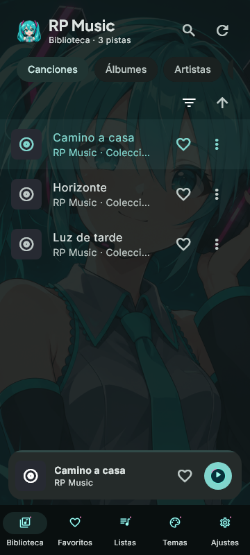
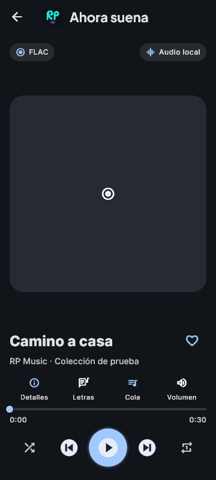

# RP Music Themes

Catálogo comunitario de temas visuales para RP Music 0.4.0 y versiones compatibles.

Los temas cambian colores, fondos, iconos de reproducción y navegación, e imágenes decorativas. RP Music conserva la distribución de las pantallas y las acciones de los controles.

## Instalar

En RP Music, abre **Temas**, elige un tema y pulsa **Descargar**. También puedes descargar [el archivo del tema](themes/minimalista.rptheme) y abrirlo desde **Temas → Importar tema**. El tema instalado funciona sin conexión.

## Crear y proponer un tema

1. Copia [la plantilla](templates/mi-tema.rptheme) y cambia su nombre y colores.
2. Sigue [la guía de creación](docs/CREAR-TEMAS.md) para añadir imágenes y probar el resultado.
3. Revisa [cómo contribuir](CONTRIBUTING.md) y envía una solicitud de cambios con tu tema y sus capturas.

## Miku · Turquesa

[Tema anime inspirado en Miku](docs/MIKU-TURQUESA.md), con fondo ilustrado, retrato chibi e iconos personalizados.

## Primer tema de prueba

[Minimalista](themes/minimalista.rptheme) usa una paleta neutra e iconos propios para reproducir, pausar y cambiar de pista. Los recursos que omite se completan con los de RP Music.

Capturas de la interfaz Flutter con canciones de prueba y reproducción simulada.

El [catálogo](catalog.json) permite que RP Music descubra y descargue los temas aceptados. Antes de incorporarlos se revisan compatibilidad, legibilidad y permisos de redistribución de los recursos.

[Repositorio de RP Music](https://github.com/Joao-s02/rp_music)
