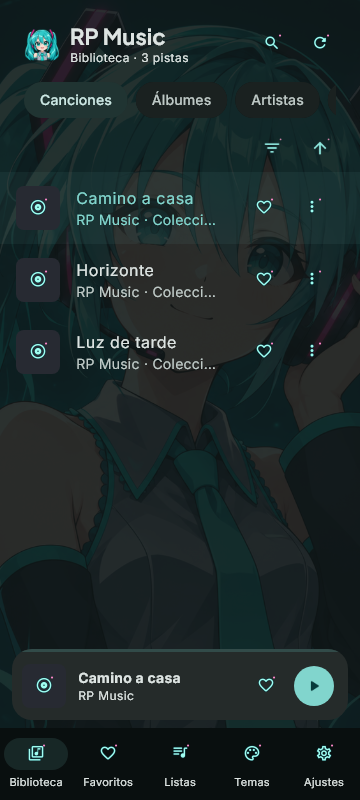
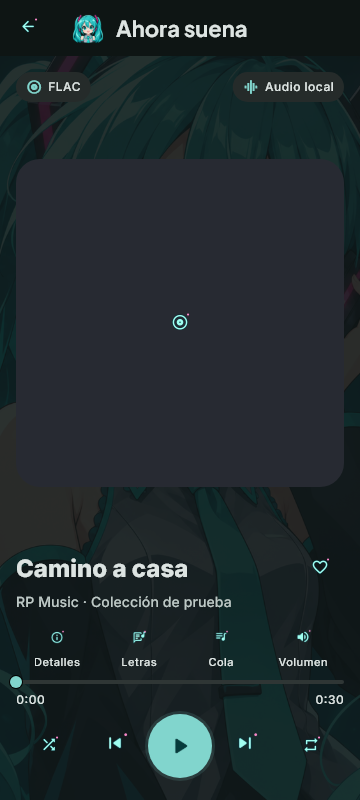
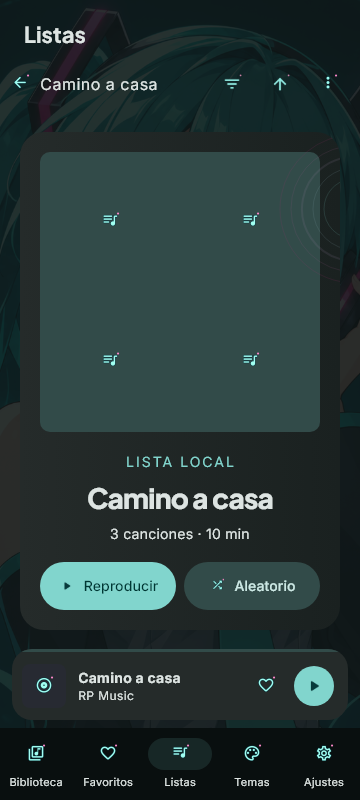
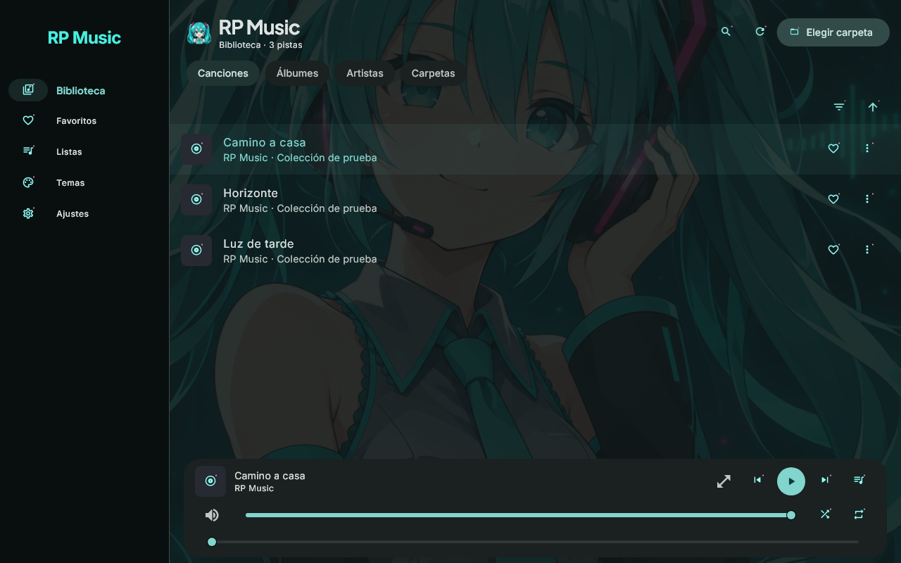

# Miku · Turquesa

Tema inspirado en Hatsune Miku. La revisión 2 para RP Music 0.4.1 incorpora 34 recursos: fondo, retrato de encabezado, iconos de biblioteca/reproductor/listas, filtros y menús. Reproducir/pausa usan glifos centrados dentro del botón de la app.

En RP Music 0.4.1 abre Temas → Catálogo y descarga o actualiza Miku · Turquesa. Puedes importar [revisión 2](../themes/miku-turquesa-v2.rptheme) desde Temas → Descargados → Importar tema. El paquete requiere como mínimo build 33; la release pública 0.4.1 usa build 35.

RP Music 0.4.0 conserva [la revisión original](../themes/miku-turquesa.rptheme), con 13 recursos. El catálogo mantiene esa entrada base y añade la actualización compatible, sin romper la descarga anterior.

Las ilustraciones se generaron con ImageGen para este tema. Los iconos derivan de Google Material Icons; créditos, modificaciones y licencia están incluidos en el paquete. No se ejecuta código ni se cambia la distribución.

Capturas Flutter con canciones de ejemplo y reproducción simulada; no son pruebas físicas.

