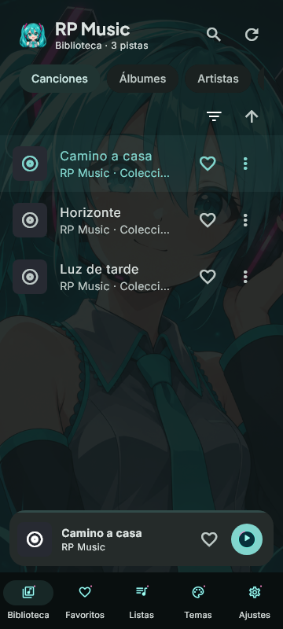
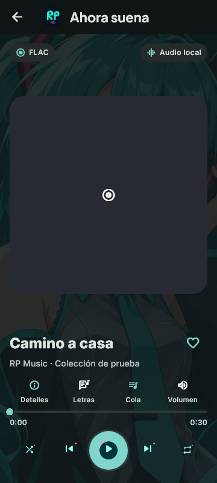
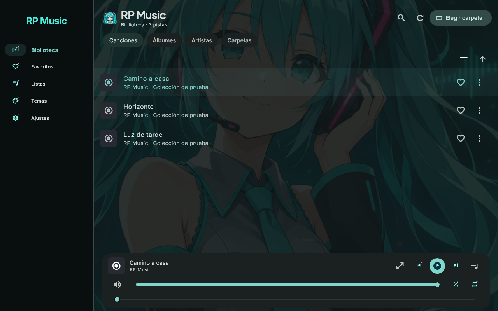

# Miku · Turquesa

Tema de prueba para RP Music 0.4.0 inspirado en Hatsune Miku. Incluye fondo anime, retrato chibi en Biblioteca, once iconos de navegación/reproducción y acentos turquesa y rosa. La paleta se adapta a la preferencia clara u oscura.

Abre Temas en RP Music y descarga Miku · Turquesa. También puedes importar [el paquete](../themes/miku-turquesa.rptheme) desde un archivo.

Las ilustraciones se generaron con ImageGen para este tema. Los iconos se adaptaron desde Google Material Icons incluido en Flutter. El paquete incorpora los créditos, los cambios realizados y el texto de la licencia del proveedor.

Las capturas usan la interfaz de Flutter con canciones de ejemplo y reproducción simulada. Se verificaron carga, aplicación y restauración en un perfil de prueba, junto con vistas móvil y escritorio.

